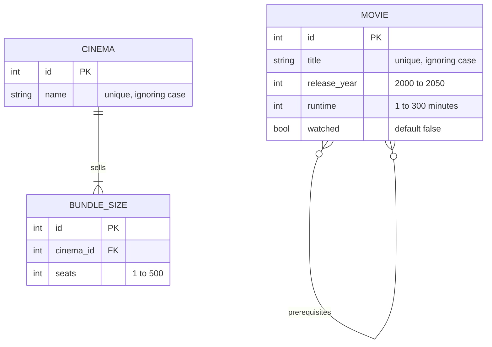

# Doomsday Ready

A small full-stack app that helps MCU fans plan their rewatch before *Avengers: Doomsday* and book an opening-night watch party.

- **Backend:** Django + Django REST Framework, SQLite
- **Frontend:** React (Vite) + Tailwind CSS
- **Feature 1:** movies with prerequisites, circular-dependency protection, and a rewatch order
- **Feature 2:** cinemas with seat bundles, and a booking quote (fewest bundles for an exact group size)


## Live demo

- App: https://doomsday-ready-2770.onrender.com/
- API: https://doomsday-ready-j5y7.onrender.com/api/movies

The demo runs on Render's free plan, so two things to know:

- The backend goes to sleep after 15 minutes without traffic. The first request after a quiet period can take about a minute, and may fail once. Refresh and it works.
- The free Postgres database expires 30 days after it was created (on or around DD Month YYYY), after which the live demo will stop working. The code and the local setup below are unaffected.

## Project layout

```
Doomsday_Ready/
├── backend/
│   ├── manage.py
│   ├── requirements.txt
│   ├── doomsday/            Django project settings and root URLs
│   └── core_app/
│       ├── models.py        Movie, Cinema, BundleSize
│       ├── serializers.py   MovieSerializer
│       ├── views.py         the algorithms and the API views
│       ├── urls.py          the API routes
│       └── tests.py         unit and API tests
└── frontend/
    └── src/
        ├── App.jsx          three tabs
        ├── api.js           all calls to the backend
        └── components/      MoviesView, RewatchView, BookingView
```

## How to run

You need Python 3 and Node.js 18 or newer.

### Backend

```bash
cd backend
python -m venv my_env
source my_env/Scripts/activate        # Windows (Git Bash). On Mac/Linux: source my_env/bin/activate
pip install -r requirements.txt
cp .env.example .env
python manage.py migrate
python manage.py runserver
```

The API is now at `http://127.0.0.1:8000/api/`.

### Frontend

In a second terminal:

```bash
cd frontend
npm install
npm run dev
```

Open `http://localhost:5173`. The Vite dev server forwards every `/api` request to the backend on port 8000, so both servers must be running.

### Tests

```bash
cd backend
python manage.py test
```

41 tests: unit tests for the algorithms, and API tests that check the brief's examples through the real endpoints.

### Sample data

There is no seed command. Add the movies on the **Movies** tab. The brief's example (title, prerequisites):

| Movie | Watch these first |
|---|---|
| Iron Man | none |
| Captain America: The First Avenger | none |
| The Avengers | Iron Man, The First Avenger |
| Captain America: Civil War | The Avengers |
| Thor: Ragnarok | none |
| Avengers: Infinity War | Civil War, Ragnarok |
| Avengers: Endgame | Infinity War |
| Avengers: Doomsday | Endgame |

The brief gives no years or runtimes, so any values you enter are placeholders.

The app has no screen for adding cinemas (the brief does not ask for one). Create the booking examples through the API:

```bash
curl -X POST http://127.0.0.1:8000/api/cinemas -H "Content-Type: application/json" -d '{"name": "Starlight", "bundle_sizes": [1, 3, 4]}'
curl -X POST http://127.0.0.1:8000/api/cinemas -H "Content-Type: application/json" -d '{"name": "Galaxy", "bundle_sizes": [2, 5]}'
curl -X POST http://127.0.0.1:8000/api/cinemas -H "Content-Type: application/json" -d '{"name": "Nova", "bundle_sizes": [6, 9, 20]}'
curl -X POST http://127.0.0.1:8000/api/cinemas -H "Content-Type: application/json" -d '{"name": "Orbit", "bundle_sizes": [4, 6]}'
```

## Data model



- **Prerequisites** are a many-to-many link from a movie to other movies. The link is one-way: "The Avengers needs Iron Man" does not mean the reverse.
- A **cinema** owns one `BundleSize` row per size it sells. A size can appear only once per cinema, but different cinemas can sell the same size.

## API

All endpoints are under `/api`, with no trailing slash.

| Method and path | Purpose |
|---|---|
| `POST /movies` | Create one movie |
| `GET /movies` | List movies |
| `PATCH /movies/:id` | Update a movie (including `watched` and `prerequisites`) |
| `GET /movies/:id/rewatch-order` | Rewatch order |
| `POST /cinemas` | Create one cinema |
| `GET /cinemas` | List cinemas |
| `GET /cinemas/:id/booking?groupSize=6` | Booking quote |

### Request and response examples

Create a movie. Prerequisites are a list of movie ids:

```json
POST /api/movies
{"title": "The Avengers", "release_year": 2012, "runtime": 143, "prerequisites": [1, 2]}
```

Rewatch order:

```json
GET /api/movies/8/rewatch-order
{
  "target": {"id": 8, "title": "Avengers: Doomsday"},
  "order": [{"id": 1, "title": "Iron Man", "runtime": 126, "watched": true}],
  "total_count": 7,
  "watched_count": 1,
  "remaining_runtime_minutes": 874
}
```

Booking quote:

```json
GET /api/cinemas/3/booking?groupSize=11
{
  "cinema_id": 3,
  "group_size": 11,
  "possible": true,
  "total_bundles": 4,
  "bundles": [{"size": 5, "count": 1}, {"size": 2, "count": 3}]
}
```

When no exact combination exists, the response is `200` with `"possible": false` and an empty `bundles` list.

### Errors

Every error has the same shape: `{"code": "...", "message": "..."}`.

| Code | Status | When |
|---|---|---|
| `VALIDATION_ERROR` | 400 | A field breaks a rule (runtime, year, bundle sizes, `groupSize`, unknown prerequisite id) |
| `NOT_FOUND` | 404 | The movie or cinema id does not exist |
| `DUPLICATE_NAME` | 409 | The title or cinema name already exists |
| `CIRCULAR_DEPENDENCY` | 409 | The prerequisites would create a loop |

## How the logic works

The algorithms are plain functions in `backend/core_app/views.py`, written without graph or optimisation libraries.

### Circular dependencies (`would_create_cycle`)

A movie M given new prerequisites causes a loop if one of them is M itself, or if M is already somewhere in the prerequisites of one of them. The function reuses `rewatch_order` to get that full list and checks whether M is in it. The check runs on every `PATCH` before anything is saved, so a rejected request changes nothing. A newly created movie cannot be part of a loop, because no movie depends on it yet, so only updates need the check.

### Rewatch order (`rewatch_order`)

A depth-first search. To list a movie's prerequisites, go through each one: first list what that prerequisite needs (the function calls itself), then add the prerequisite. A movie is skipped if it is already in the list, so a movie reached by two paths appears once. Every movie therefore comes after its own prerequisites, and the target is never added. Movies with no ordering between them are visited in id order, so the output is stable.

### Booking quote (`min_bundles`)

Dynamic programming, the same idea as the minimum coin change problem. For each seat count from 1 up to the group size, it keeps the fewest bundles needed to reach exactly that count, built from the smaller counts. It also remembers which bundle size was used last, so the answer can be rebuilt at the end. Taking the largest bundle each time (greedy) is not correct: for sizes 1, 3, 4 and 6 seats it gives 3 bundles instead of 2. The cost is at most 10,000 × 10 steps.

## Assumptions and decisions

The brief leaves these open, so these are the choices made:

- **Release year** must be between 2000 and 2050. The 1 to 300 limit in the brief is applied to the runtime only.
- **Titles and cinema names** are unique ignoring capital letters, and repeated spaces are collapsed to one (`"iron   man"` counts as `"Iron Man"`). This is enforced by a database constraint and by the API.
- **One movie or cinema per create request.** Creating several at once is not supported.
- **Prerequisites are referenced by movie id.**
- **A newly created movie cannot cause a loop**, so the circular-dependency check runs on `PATCH`.
- **Cinema rules:** 1 to 10 bundle sizes, all different, each from 1 to 500. A cinema's sizes are set when it is created.
- **Group size** must be a whole number from 1 to 10,000.
- **"Not possible" is not an error.** The booking endpoint answers `200` with `possible: false`.
- **Ties:** when several combinations use the same number of bundles, the first one found is returned.
- **Rewatch summary:** `watched_count` and `remaining_runtime_minutes` count only the movies in the rewatch list, never the target. The remaining time is the total runtime of the unwatched ones.
- **Database:** SQLite, to keep setup to a few commands.

## Known limitations

- The Django admin saves straight to the database and skips the API's rules (the loop check and the space cleanup). Use the app or the API to add data.
- No screen for creating cinemas, no delete endpoints, no authentication, since the brief does not ask for them.
- The frontend does not handle the server being down.
- No Docker Compose (optional bonus, not done).

## AI usage


I used an AI assistant (Claude) as a step-by-step guide while building this project. It was used for:

- planning the project order and the API design,
- suggesting code for the models, the algorithms, the views, the tests and the React components,
- explaining errors and concepts as I went.

I ran every step myself, checked the results against the brief's examples, and simplified the code where I could not explain it.